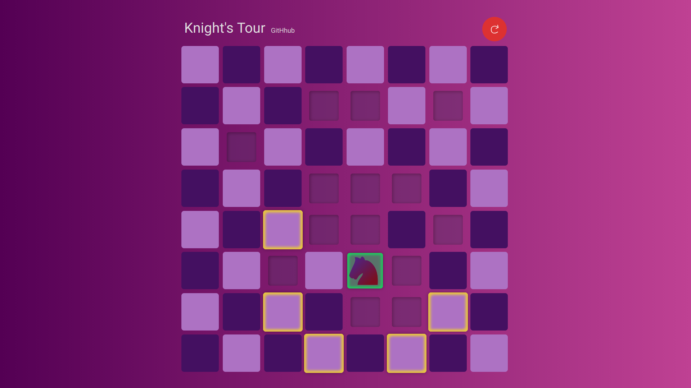
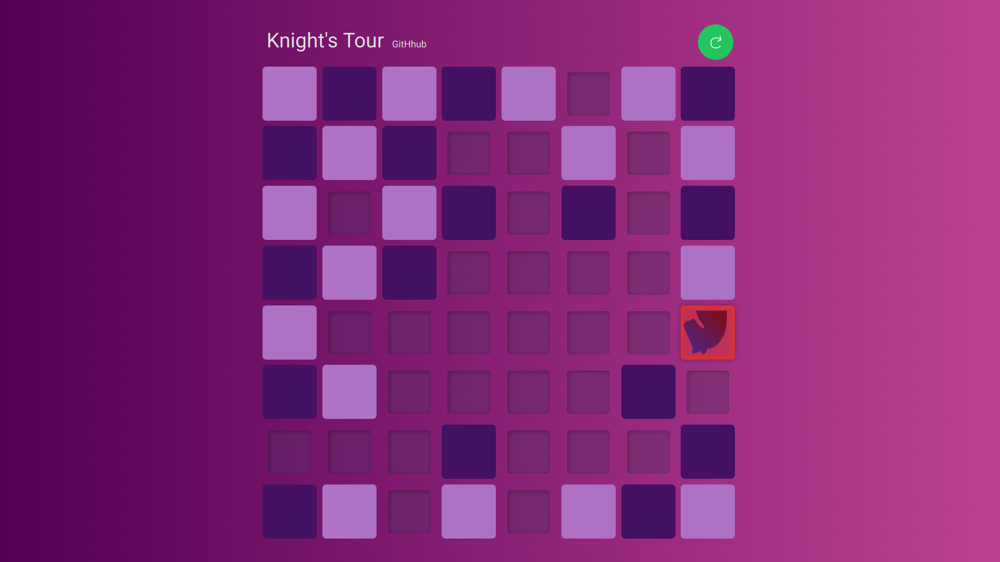

# Knight's Tour

An interactive implementation of the classic Knight's Tour puzzle. Move a chess knight across the board and try to visit every square exactly once.

**[Live Demo](https://knights-tour-zeta.vercel.app/)** · [Source Code](https://github.com/TohidEq/knights-tour)

## Preview





## Getting Started

### Prerequisites

Make sure you have the following installed:

- [Node.js](https://nodejs.org/)
- [Git](https://git-scm.com/)
- npm (included with Node.js)

### 1. Clone the repository

```bash
git clone https://github.com/TohidEq/knights-tour
cd knights-tour
```

### 2. Install dependencies

```bash
npm install
```

### 3. Start the development server

```bash
npm run dev
```

Open the local URL shown in your terminal (usually [http://localhost:3000](http://localhost:3000)).

### 4. Build for production

To create an optimized production build:

```bash
npm run build
```

To preview the production build locally:

```bash
npm run preview
```

## Available Scripts

| Command | Description |
| --- | --- |
| `npm run dev` | Start the development server. |
| `npm run build` | Type-check and build the application. |
| `npm run preview` | Preview the production build. |
| `npm run build-css` | Watch and compile Tailwind CSS. |

## Built With

- React 18
- TypeScript
- Vite
- Tailwind CSS
- React Router
- PostCSS
- Autoprefixer
